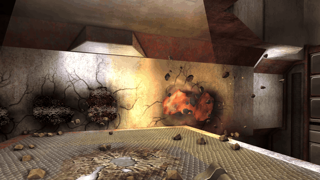
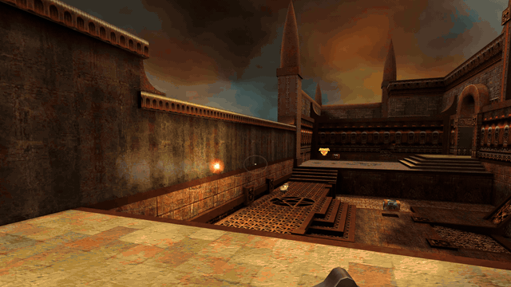
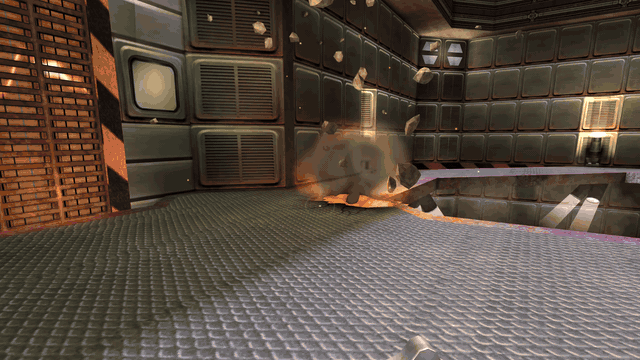
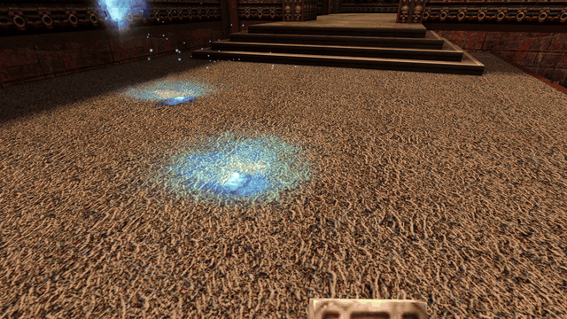
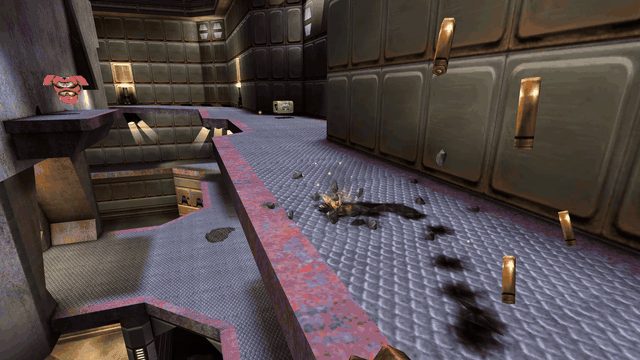
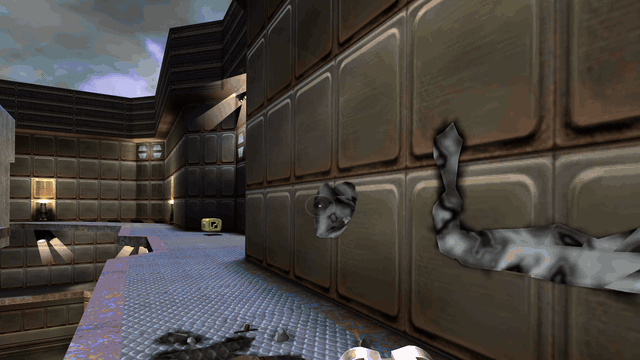
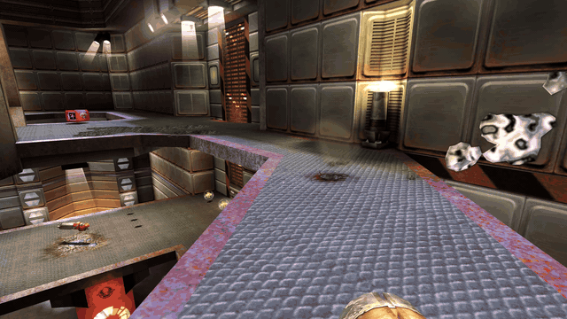
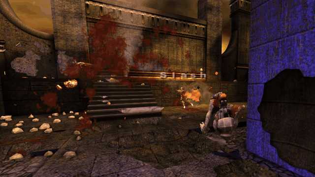
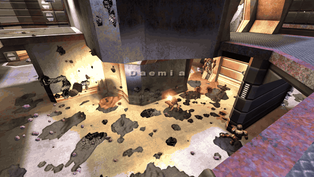

# Wrecked Quake III Arena



Destructible walls for Quake III Arena. Rockets blast craters into walls, other weapons chip, melt and bore into them, and rubble in the wall's own material piles up on the floor. Published by breakVanilla.

Players download a ready zip from the [releases page](https://github.com/breakvanilla/quake-iii-arena-wrecked/releases/latest); the `Wrecked Quake III Arena README.txt` inside it explains how to install. You need your own copy of Quake III Arena with the 1.32 point release (`baseq3/pak0.pk3` through `pak8.pk3`; the Steam version has them).

## In action

<table>
<tr><td><br>Stone walls crumble into rubble</td><td><br>Rockets crater the floor</td></tr>
<tr><td><br>Plasma melts glowing pits</td><td><br>Machine gun chips add up to a pit</td></tr>
<tr><td><br>Shotgun pellets chip the wall</td><td><br>The railgun bores a deep hole</td></tr>
<tr><td><br>Quad Damage rockets blast the arches</td><td><br>Bots fight in a cratered pit</td></tr>
</table>

Gameplay videos with the mod, no commentary: [Vertical Vengeance](https://youtu.be/W8W6YUmb4N0), [House of Pain](https://youtu.be/tY0gEcNF2fg), [bots on Vertical Vengeance](https://youtu.be/CagrNyAXaXU), [bots on Temple of Retribution](https://youtu.be/eFavtv1uSqY).

Website: [breakvanilla.com](https://breakvanilla.com/). Videos: [youtube.com/@BreakVanilla](https://www.youtube.com/@BreakVanilla).

## What is in this repository

- `patches/`: the mod's changes to ioquake3, one patch per part of the engine: holes in the collision model (`01-collision-holes`, with the new file `code/qcommon/cm_holes.c`), hole console commands and keeping things inside craters visible (`02-server`), the weapons that make them (`03-game`), the effects (`04-cgame`), crater meshes (`05-client-crater-meshes`) and cutting the holes in the OpenGL 2 renderer (`06-renderer`).
- `package/`: what the release zips carry besides the game: the player's README and the launcher, for macOS and Windows.
- `scripts/`: the mod's shaders.
- `docs/`: the GIFs in this README.
- `tools/`: Python scripts that generate the mod's textures, rubble models and sounds at build time, and `update-patches.sh`, which writes engine changes back into `patches/`.
- `build.sh`: on the first run clones ioquake3 into `local/engine/` at upstream commit `87a99d1` of https://github.com/ioquake/ioq3 and applies `patches/`. Then it builds the engine and the game code for macOS and installs the mod pk3 into `~/Library/Application Support/Quake3/wrecked-quake-iii-arena/`.
- `package-mac.sh`: packs the macOS release zip into `local/dist/`. Run `build.sh` first.
- `package-windows.sh` and `mingw-w64.cmake`: cross-compile the game for 64-bit Windows on macOS and pack the Windows release zip into `local/dist/`. Run `build.sh` first, it makes the pk3.

## Building

Needs macOS with Xcode command line tools, CMake and Python 3. The Windows build also needs MinGW-w64 (`brew install mingw-w64`).

```sh
./build.sh
./package-mac.sh
./package-windows.sh
```

To play the build, run `local/engine/build/Release/ioquake3.app` with `+set fs_game wrecked-quake-iii-arena`.

## Changing the engine

`local/engine/` is a plain git clone of ioquake3 and is not part of this repository; `git -C local/engine diff` shows everything the mod changes. Edit the code there, then run `tools/update-patches.sh` to write the changes back into `patches/`. `build.sh` warns when `local/engine/` has changes that are not in `patches/` yet. If a changed file is outside the six parts, `update-patches.sh` stops; add its directory to `PARTS` in the script.

To move to a newer ioquake3: run `tools/update-patches.sh`, move `local/engine/` away, set `IOQ3_REV` in `build.sh` to the new upstream commit and run `build.sh`. Patches that no longer apply cleanly leave conflict markers in `local/engine/`; fix them, run `tools/update-patches.sh` and build again.

## Console settings

- `cg_destruction 0` turns the effects off on the client, `g_destruction` sets the crater size on the server (default 40, 0 turns holes off).
- `cg_shake`: view shake, 0 turns it off.
- `cg_rubbleTime`: seconds rubble stays on the floor.

## License

GNU General Public License version 2 or (at your option) any later version, see `LICENSE`. Third-party libraries in ioquake3's `code/thirdparty/` (SDL, zlib, curl, OpenAL Soft and others) keep their own licenses. The engine is ioquake3 (https://ioquake3.org), based on the Quake III Arena source code released by id Software. Quake III Arena game data is not included and is not covered by this license.
